# Soft Pneumatic Gripper Picking Fruit - Simscape&trade; and Model-Based Design

<!-- project-download-link:start -->
📦 Download this project [here](https://github.com/mathworks/Research-Office-Projects/releases/download/project-downloads/example-soft-gripper-fruit-picking.zip).
<!-- project-download-link:end -->

A UR5e arm with a **four-finger soft pneumatic gripper** picks an apple, a tomato and a pear from a table and
places each one in a tray. Air pressure bends the fingers, and the bending changes the chamber volume, which
changes the pressure again. All of this is modelled physically in Simscape&trade;, with no FEM and no
lookup-table actuator. The finger is validated against published hardware data, and the whole project was built
with an **AI agent following a written Model-Based Design guide**, which ships here so you can reuse it.

| | | |
|:---:|:---:|:---:|
| 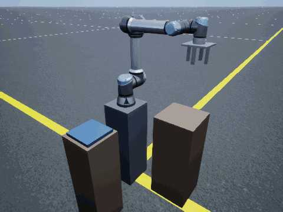 | 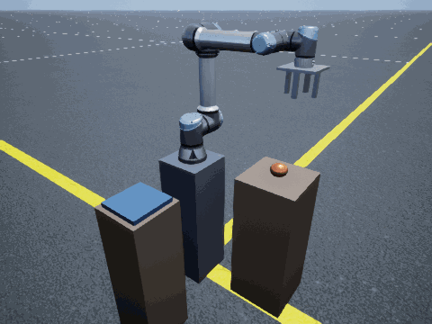 | 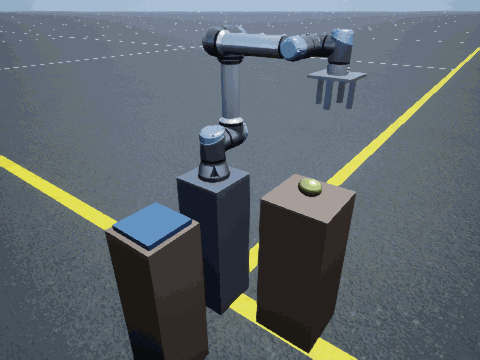 |
| Apple, 200.6 g, 45 kPa | Tomato, 282.9 g, 39.2 kPa | Pear, 389.1 g, 60 kPa |
| 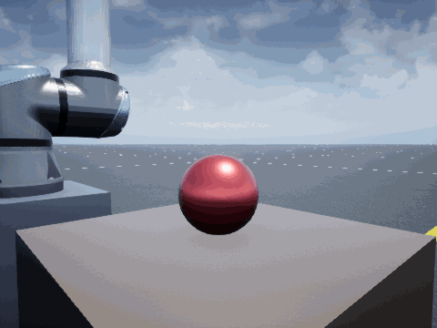 | 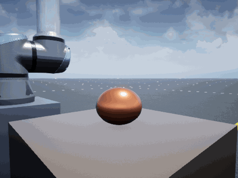 | 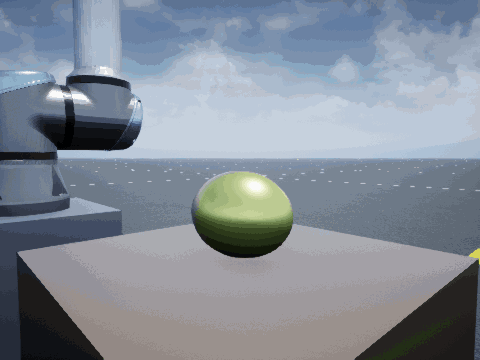 |
| The straight fingers curl around the fruit as the chambers fill | Tightest bruise margin: 10.5 N against an 11 N limit | Heaviest fruit; lifted at 1 m/s&sup2; |

*The Unreal Engine&reg; replays are drawn from the logged simulation only. The 3D scene has no path back into
the physics.*

**What this example shows you**

- How to model a **soft actuator in Simscape Multibody&trade;**: an 8-hinge pseudo-rigid-body finger, coupled to
  a **Simscape gas network** through one Rotational Mechanical Converter per chamber.
- How to **identify** the finger from a published force table and **validate** it against four independent
  hardware tables, predicting each result before running it.
- How to close the loop with a **Stateflow&reg; pick controller** that checks the grasp using only the fingers'
  bend sensors.
- How a full **Model-Based Design workflow** (requirements → validated plant → design → verification → handoff)
  runs with an AI agent, and where the research scientist stays in charge.

## Setup

### Required products (MATLAB&reg; R2026b)

| Product | Used for |
|---------|----------|
| MATLAB&reg; | Scripts, parameters, the offline finger model |
| Simulink&reg; | Closed-loop model |
| Simscape&trade; | Gas network: regulator, manifold, finger chambers |
| Simscape&trade; Multibody&trade; | Finger hinges, fruit, contact forces, UR5e arm |
| Stateflow&reg; | Pick controller |
| Robotics System Toolbox&trade; | UR5e model (`loadrobot`), inverse kinematics, Simulation 3D Robot block |

**Optional**

| Product | Used for |
|---------|----------|
| Simulink&reg; 3D Animation&trade; | Unreal Engine replay and the GIFs (`playSoftGripperPick`) |
| Optimization Toolbox&trade; | Re-identifying the finger from the data (`fit_zhu_finger_prb`, `plotSoftGripperFigures`) |
| Requirements Toolbox&trade; | Opening `docs/SoftGripper_Requirements.slreqx` |

R2026b is needed for the `JointConfiguration` port of the Simulation 3D Robot block used by the replay.

## How to run

Open MATLAB in this folder, then:

```matlab
runSoftGripperExample        % simulate one pick, score it against the requirements, replay it in 3D
```

To call any other script directly, run `setupSoftGripperExample` once per session first. It puts the code
folders on the path (`runSoftGripperExample` does this for you).

| What | Command | Time |
|---|---|---|
| Replay a saved pick only (no simulation) | `playSoftGripperPick(3)` (3 apple, 4 tomato, 5 pear) | ~1 min |
| Close-up replay of the grasp | `playSoftGripperPick(3, 30, "close")` | ~1 min |
| Full closed-loop pick | `runSoftGripperExample` (set `objId`; `doSimulate = false` to replay only) | **22–32 min** for 5.7–7.2 s simulated |
| Finger free-bend check vs the paper | `check_softgripper_finger("T-F1")` | ~80 s |
| Finger force check, 29 points | `check_softgripper_finger("T-F2")` | ~4.5 min |
| README figures | `plotSoftGripperFigures` | seconds |

The shipped `results/pick_3|4|5.mat` are **replay copies** (five signals, resampled to 200 Hz). Running a pick
overwrites them with the full log. No script changes a model file; every parameter goes in through
`Simulink.SimulationInput`.

## How it works

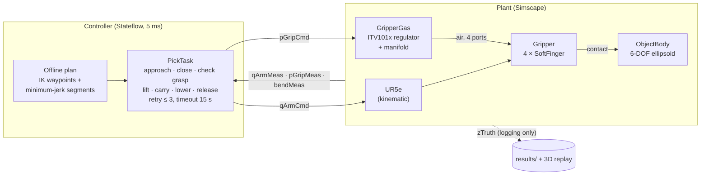

The controller sees only what a real gripper could measure: arm joint angles, manifold pressure and one bend
sensor per finger. Contact forces, fruit pose and slip are **truth signals**. They are logged for scoring and
the replay, and a structural check (`verify_softgripper_hierarchy`) proves that none of them reaches the
controller.

| Top level: controller ↔ plant | Plant |
|:---:|:---:|
| 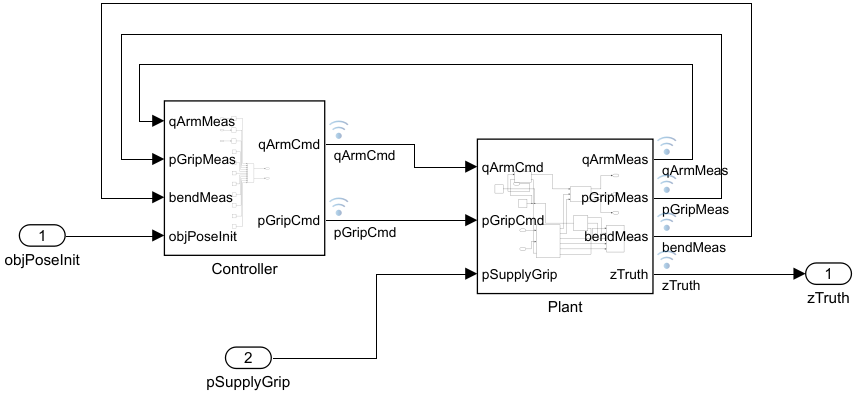 | 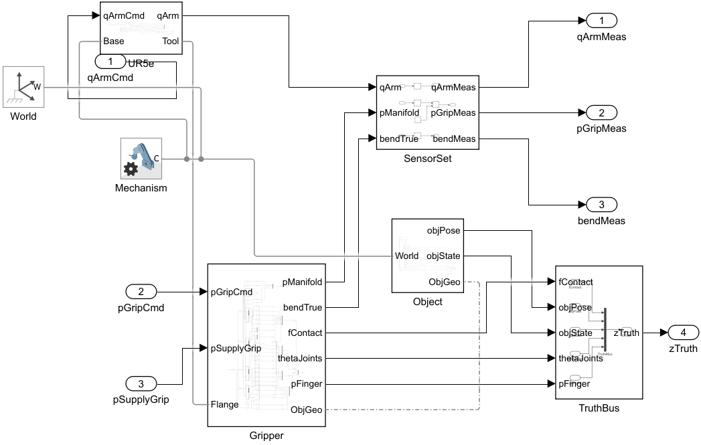 |

### The soft finger: eight hinges and a gas chamber each

Each finger (`SoftFinger.slx`) is a chain of 8 `Hinge.slx` references, one per chamber of the real finger.
In every hinge, a **Rotational Mechanical Converter (G)** turns chamber pressure into hinge torque and hinge
rotation into chamber volume. That two-way coupling is what makes the finger *soft*: a blocked finger
compresses its own air.

| `Hinge.slx`: one chamber | `SoftFinger.slx`: 8 hinges in series |
|:---:|:---:|
| 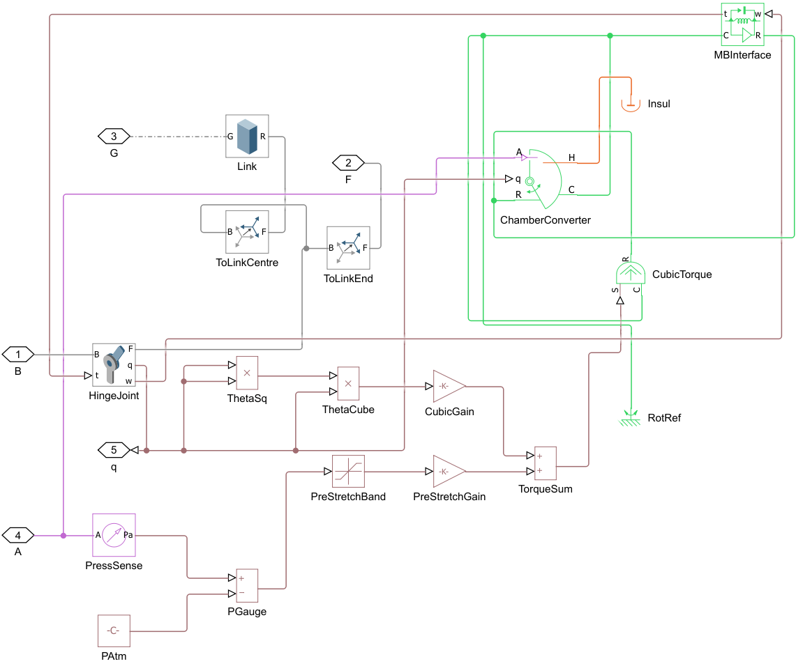 | 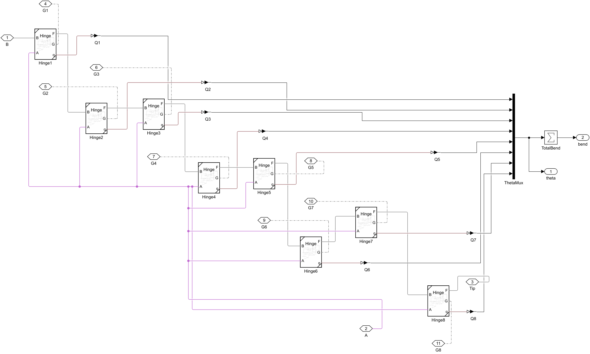 |

Per hinge *i*, with the pressure *p* acting above a pre-stretch dead zone *p*<sub>0</sub>:

<p align="center">
<i>K</i>&thinsp;θ<sub>i</sub> + <i>K</i><sub>3</sub>&thinsp;θ<sub>i</sub><sup>3</sup> = <i>D</i>&thinsp;max(<i>p</i> − <i>p</i><sub>0</sub>, 0) + <i>M</i><sub>contact,i</sub>
&emsp;&emsp;
<i>V</i> = <i>V</i><sub>0</sub> + <i>D</i>&thinsp;Σθ<sub>i</sub>
</p>

*L* = 105 mm, *D*, *K*, *K*<sub>3</sub> and *p*<sub>0</sub> are **identified** from Zhu et al. Table 1, because the
paper publishes none of them (`fit_zhu_finger_prb.m`). The cubic term models silicone stiffening as it
stretches.

| Air supply: `GripperGas.slx` | Pick controller: `PickTask` chart |
|:---:|:---:|
| 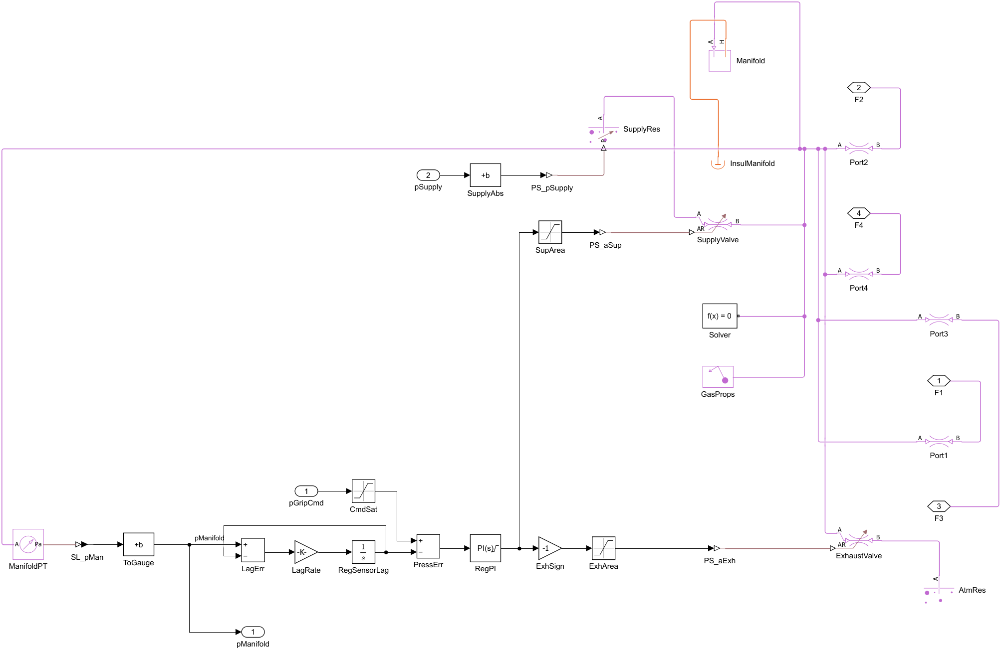 | 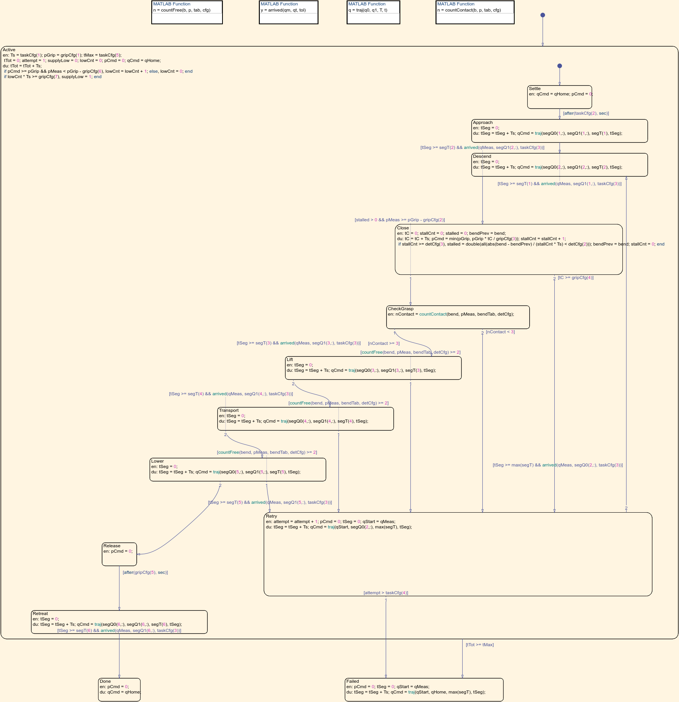 |

The regulator is an SMC ITV101x-class proportional valve: a PI loop on the manifold pressure with clamping
anti-windup, and supply and exhaust valves sized from the catalogue flow curve via ISO 6358. One manifold feeds
all four fingers through 2 mm ports.

## Validated against hardware data

The finger was validated against **Zhu et al., *Sensors* 22:4532 (2022)** before any controller existed. Every
test's result was predicted before the run.

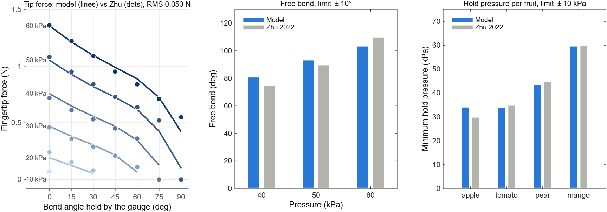

| Check (stage) | Model | Hardware / prediction | Limit | Result |
|---|---|---|---|---|
| Tip force, Zhu Table 1, 29 points (component) | RMS 0.050 N, max 0.127 N | measured | RMS ≤ 0.08 N | ✅ |
| Free bend at 40 / 50 / 60 kPa (component) | 81 / 94 / 104° | 75 / 90 / 110° | ± 10° | ✅ |
| Sealed finger obeys the gas law (component) | −0.008 % | adiabatic *pV*<sup>γ</sup> | 1 % | ✅ |
| Fill time 0 → 95 % of 60 kPa (component) | 17.7 ms | 17.3 ms, nozzle prediction | ± 10 % | ✅ |
| Enveloping grasp force, Zhu Table 3, 30–60 kPa (integrated) | 1.64 / 3.30 / 5.40 / 7.51 N | 2.28 / 3.47 / 4.68 / 5.80 N | ± 30 % | ✅ 4/4 |
| Minimum hold pressure, Zhu Table 4 (integrated) | apple 34, tomato 34, pear 44, mango 60 kPa | 30 / 35 / 45 / 60 kPa | ± 10 kPa | ✅ 4/4 |

The Simscape finger reproduces the offline identification to 0.0000 N at all 29 points. The remaining gap to
the data comes from the 8-hinge model form, not from the Simscape build. Full pass/fail per requirement:
[`docs/soft-gripper-verification.md`](docs/soft-gripper-verification.md).

## One pick, step by step

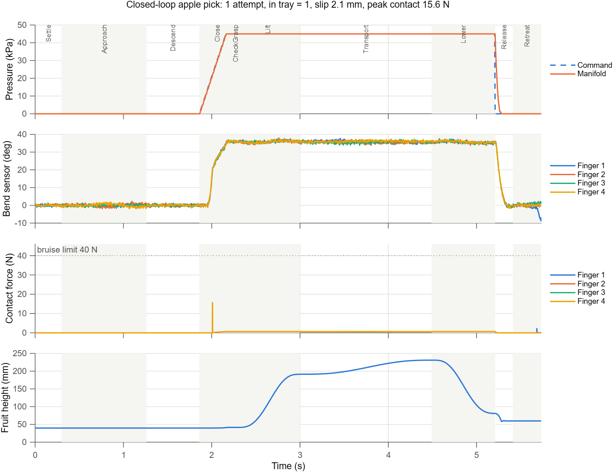

The pressure ramps to 45 kPa over 0.3 s and the four bend sensors rise together. The controller declares a
grasp once all four bend sensors have stopped moving and at least 3 fingers sit short of their free-bend angle,
because the fruit is in the way. During the carry, a drop detector watches for 2 or more fingers bending further. One short impact peak
(15.6 N) stays well under the apple's 40 N bruise limit. Then the arm lifts, carries and lowers the apple, and
venting releases it into the tray.

| Fruit | Grip pressure | Released in tray | Attempts | Slip (≤ 5 mm) | Peak contact / bruise limit |
|---|---|---|---|---|---|
| Apple 200.6 g | 45 kPa | 5.21 s | 1 | 2.1 mm | 15.6 / 40 N |
| Tomato 282.9 g | 39.2 kPa | 5.21 s | 1 | 2.1 mm | 10.5 / 11 N |
| Pear 389.1 g (lying) | 60 kPa, lift at 1 m/s&sup2; | 5.72 s | 1 | 3.1 mm | 26.3 / 40 N |

Every design number in the controller (sample time, closing ramp, grasp-check thresholds, per-fruit pressure)
traces to a row of [`docs/rationale.md`](docs/rationale.md).

## Built with Model-Based Design and an AI agent

The project was run by a generic AI agent (with the Simulink Agentic Toolkit) working with a research scientist,
following [`MBD-CHEAT-SHEET.md`](MBD-CHEAT-SHEET.md). The agent built, ran and reported. It stopped at each
gate, and the research scientist made every call on physics, tolerances and tradeoffs.

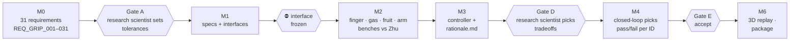

**Drop [`MBD-CHEAT-SHEET.md`](MBD-CHEAT-SHEET.md) into your own project to run it the same way.** It is one
file: a quick start for you at the top, and the agent's instructions below.

## Limits of validity: read before reusing

- **Pressure 30–60 kPa.** Below about 30 kPa the fingers do not reach the fruit: the identified pre-stretch
  dead zone is 13 kPa, and the 60 mm finger spacing leaves a gap.
- **Fruit about 70–110 mm across.** A raspberry or cherry tomato (20–30 mm) cannot be grasped at this spacing:
  the fingers sweep past it on a table, and when it hangs from a stem they push it up and break the stem.
- **The mango (580 g) is beyond the 60 kPa finger rating while moving.** It is modelled but not picked.
- **The arm is kinematic.** It follows its joint commands exactly; there are no arm dynamics or joint
  controllers.
- **Fingertip grasp force (Zhu Table 3)** cannot be checked: the paper does not say where the test ball sat,
  and the result changes ×7 over 20 mm of ball height.
- **Estimated, not measured:** finger mass and damping, contact stiffness and damping, friction, dead volume,
  scene layout. The tomato's 5 % bruise margin depends on the damping estimates.
- **Not verified:** low friction, a leaking finger, supply droop (REQ_GRIP_024–026), robustness sweeps.

## What the example teaches

1. **Validate in the loop, not only on benches.** Benches that loaded only the fruit said the grip was safe. In
   the moving pick, the soft fingers carry their own inertia and open. The benches were redone with an effective
   gravity *g* − *a*<sub>gripper</sub> that loads fingers and fruit together.
2. **Build what you identified, and test it the way it was measured.** The first force test failed (RMS 0.49 N):
   under the gauge, the identified finger takes an S-shape with slightly negative base angles, which a hinge end
   stop in the Simscape model forbade. Removing the stop, so the model matches the identification, fixed most
   points. The second run failed because the tip slid off a frictionless plate. A prismatic "gauge slide" that
   holds the tip angle like the experiment then passed at 0.050 N, with no parameter re-tuned.
3. **How you test hold pressure matters.** Closing at full pressure and then lowering it measures *release*. A
   grasp *formed* at the working pressure holds less, and the final pressures use the second method.
4. **Closing speed is a design parameter.** A 0.1 s pressure ramp made impact spikes above the bruise limits
   (tomato 18.7 N, pear 46.5 N); 0.3 s keeps them below.
5. **Watch the solver.** Zero-crossing detection on the regulator's valve limits shrank the step to 2e-6 s
   and stalled a pick after 28 minutes. With it off, the whole pick runs in about 23 minutes. The limits are
   only kinks that the variable-step solver crosses accurately.

## Adapt it to your own soft gripper

| To change | Edit | Then re-run |
|---|---|---|
| Your finger's force data | the table in `fit_zhu_finger_prb.m` → copy *L*, *D*, *K*, *K*<sub>3</sub>, *p*<sub>0</sub> into `params_softgripper_finger.m` | `check_softgripper_finger` (T-F1, T-F2, T-F3) |
| Number of chambers / fingers, spacing | `finger.N_Joint`, `finger.n_Fingers`, `finger.r_Mount` | finger and grasp checks |
| Regulator, tubing, volumes | `params_softgripper_gas.m` (catalogue flow `Q_ANR`, `p_GripMax`, `d_Tube`, `V0`) | `check_softgripper_gas` |
| Objects: shape, mass, bruise limit, friction | `params_softgripper_objects.m` | `check_softgripper_objects`, `check_softgripper_hold` |
| Grip pressure, timing, grasp check | `params_softgripper_ctrl.m`, with a row in `docs/rationale.md` | `runSoftGripperPick` |

Re-run the checks in the order of the table: component first, then integrated, then the closed loop. This is
the validation order the example follows.

## Files

| Path | Contents |
|---|---|
| `runSoftGripperExample.m` | **Start here**. `setupSoftGripperExample.m` puts the folders below on the path |
| `models/` | `SoftGripperPick.slx` (closed loop: controller + plant); components `SoftFinger`, `Hinge`, `GripperGas`, `ObjectBody`, `UR5eArm` (Subsystem References); `SoftGripperScene3D.slx` (Unreal replay) |
| `benches/` | Component and integrated test benches: `FingerBench*`, `GasBench`, `ObjectBench`, `GripperBench`, with their parameter and run helpers |
| `params/` | `params_softgripper_*.m`: every parameter, each with unit and source; `fit_zhu_finger_prb.m`: finger identification |
| `checks/` | `check_softgripper_*.m`, `verify_softgripper_hierarchy.m`: validation tests, resumable, with an evaluate-only mode |
| `pick/` | One closed-loop pick: `planSoftGripperPick`, `runSoftGripperPick`, `scoreSoftGripperPick` |
| `replay/` | `playSoftGripperPick` and helpers (Unreal replay, GIFs); `plotSoftGripperFigures` (README figures) |
| `docs/` | System, architecture and pick-controller specs; `rationale.md`; verification report; object sourcing; `SoftGripper_Requirements.slreqx` |
| `results/` | Saved picks (replay copies) |
| `images/` | GIFs, figures, model screenshots, replay meshes |
| `MBD-CHEAT-SHEET.md` | The reusable AI-agent MBD guide, one file |

## References and acknowledgments

- Zhu, Feng, Hua, Wang, Hu, Wang, Su, *Sensors* 22(12):4532, 2022,
  [doi:10.3390/s22124532](https://doi.org/10.3390/s22124532) (open access,
  [PMC9230056](https://pmc.ncbi.nlm.nih.gov/articles/PMC9230056/)): finger geometry, Tables 1–4.
- SMC ITV1000-series electro-pneumatic regulator catalogue: flow and accuracy.
- UR5e model from Robotics System Toolbox&trade; (`loadrobot("universalUR5e")`).

This is a how-to example, not a research result. The fruit properties are partly estimated (see
`docs/soft-gripper-object-sourcing.md`).
