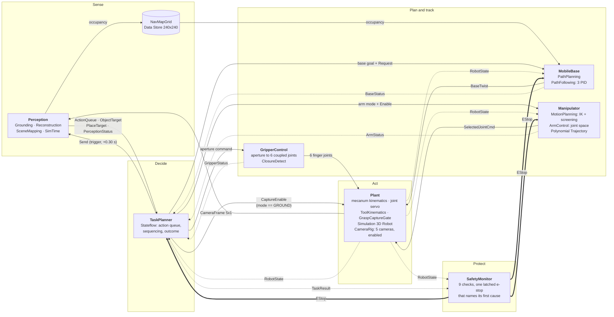
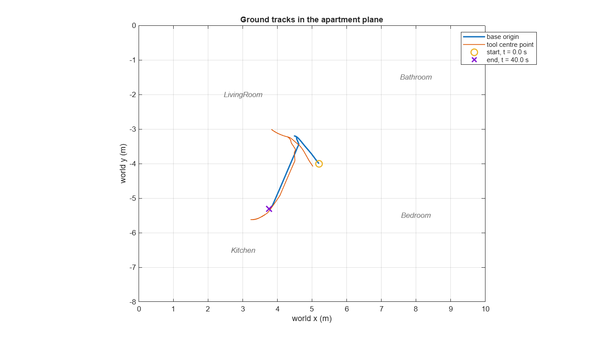
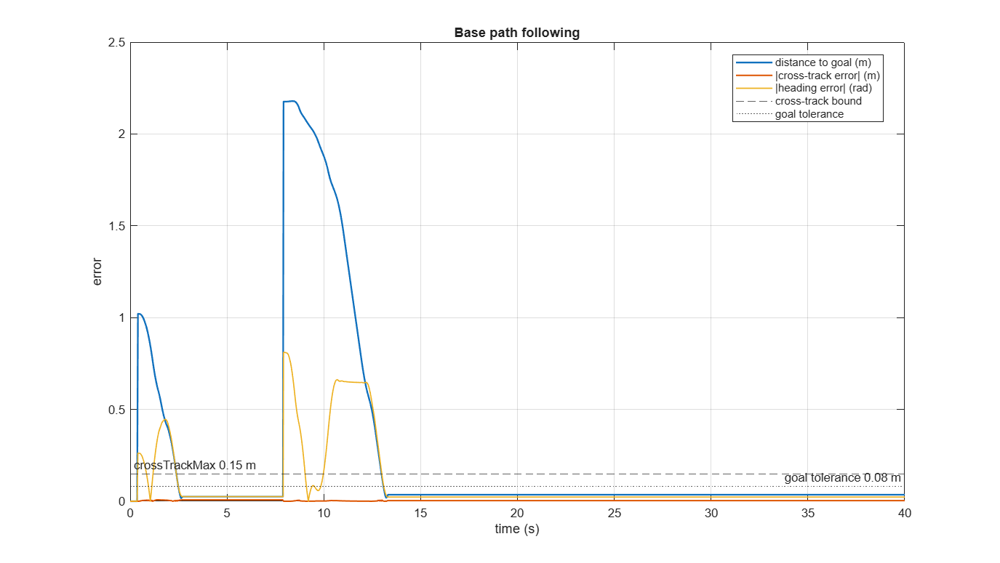
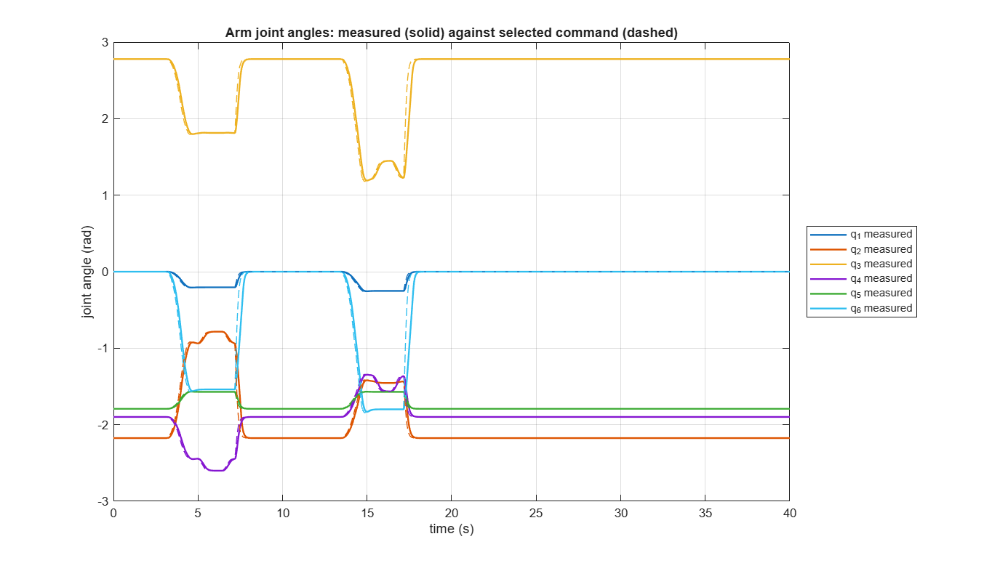
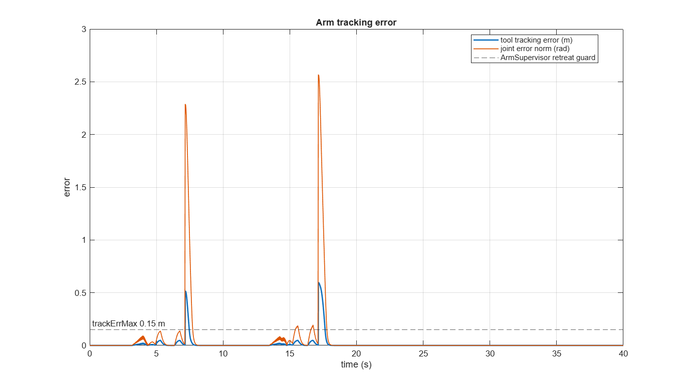
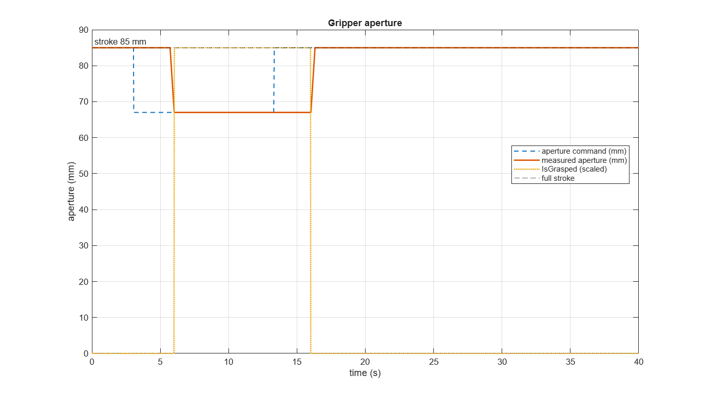
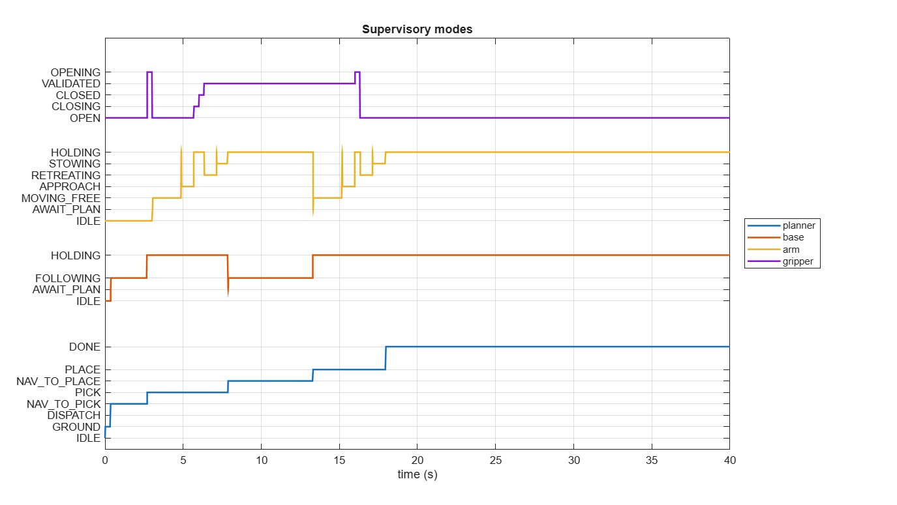
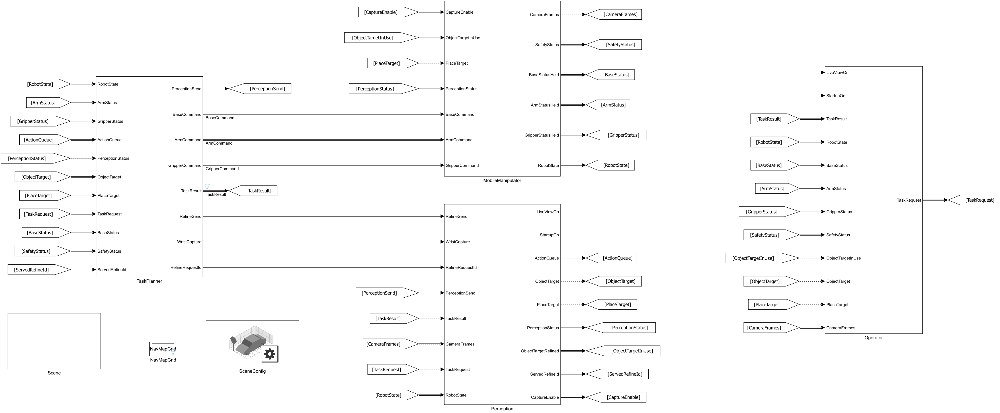

# VLA-Guided Mobile Manipulation in a Home

<!-- project-download-link:start -->
📦 Download this project [here](https://github.com/mathworks/Research-Office-Projects/releases/download/project-downloads/example-vla-guided-mobile-manipulation.zip).
<!-- project-download-link:end -->

A Simulink&reg; model of a mobile manipulator that is given one sentence of plain English and carries
it out in a photorealistic apartment rendered in Unreal Engine&reg;. Gemini Robotics-ER grounds the
instruction in four camera views, perception turns its answer into targets in metres, and four
Stateflow&reg; supervisors drive the base, the arm and the gripper through the pick and the place.


A live run of "Take the soap dispenser from the bathroom and set it next to the kitchen sink". Left, the instruction and the robot's state. Centre, the robot picking up the dispenser, with the chase camera inset. Bottom, what Gemini Robotics-ER returned: a `transfer` plan, pick point A and place point B, and then, from the wrist camera, the refined grasp point.

### Interactive App

```matlab
HomeMobileManipulatorApp
```

Type an instruction, or pick one of the three examples, and watch the robot serve it. The examples
run without a Gemini key; see **Running the Example**.

## Requirements

- **MATLAB&reg; and Simulink&reg; R2026a or later**: that is the release `homeMobileManipulator.slx` is
  saved in, and Simulink cannot open a model saved by a newer release than its own
- A supported C compiler: the model simulates in accelerator mode
- Optional: a Gemini API key with access to Gemini Robotics-ER, to run your own instructions live
  (see **Gemini Key and Offline Mode**)

| Toolbox | Usage |
|---------|-------|
| Simulink&reg; | The model, the configuration and the analysis |
| Stateflow&reg; | `TaskPlanner` and the base, arm and gripper supervisors: four charts |
| Robotics System Toolbox&trade; | `loadrobot('universalUR5e')` and `loadrobot('robotiq2F85')`, the 15-DOF `rigidBodyTree`, **Inverse Kinematics**, **Joint Space Motion Model**, **Task Space Motion Model**, **Get Transform**, `manipulatorRRT` |
| Navigation Toolbox&trade; | the base path planners (**plannerBiRRT**, **plannerRRTStar** on **stateSpaceSE2** with a **validatorVehicleCostmap**), **Coordinate Transformation Conversion**, and the occupancy grid the base plans over |
| Simulink&reg; 3D Animation&trade; | **Simulation 3D Scene Configuration**, **Simulation 3D Robot**, **Simulation 3D Camera**, **Simulation 3D Ray Tracer**, and the Unreal apartment the cameras look at |
| Automated Driving Toolbox&trade; | `vehicleCostmap`, `vehicleDimensions` and `inflationCollisionChecker`: the base's rectangular footprint check during path planning |
| Computer Vision Toolbox&trade; | `pointCloud`, `pcfitplane` and `cameraIntrinsics`: fitting the support surface under an object and the camera model |
| Image Processing Toolbox&trade; | `bwconncomp`, `bwdist` and `imfill`: segmenting the object's top face in the wrist depth image, and free-space checks on the map |

## Overview

A mobile manipulator is given one sentence of plain English — *"Pick up the red mug from the side table and set it down on the kitchen counter."* — and has to turn it into a drive across an apartment, a grasp and a place. `homeMobileManipulator.slx` builds the whole loop: a vision-language-action provider grounds the instruction against camera frames rendered from a photorealistic Unreal apartment, a perception service reconstructs the named object in metres and fits its support surface, three planning services turn those targets into a base path and an arm trajectory, four Stateflow supervisors sequence the task, and a safety monitor watches nine independent limits with a latched authority no planner can clear. The interesting engineering is not the grasp — it is everything that has to be true before a grasp is allowed: that a phrase became a pose, that the pose is reachable from where the base can actually park, that the plan was screened before it was tracked, and that a network service which can time out is not on the critical path of a robot that is already moving.

## Model Architecture



Solid arrows are commands, dotted arrows are the state and status feedback that closes each loop, and the double arrows are the e-stop — drawn separately because it is not a signal any of the three consumers may ignore. Three loops are worth following:

- **the tracking loop** — `Plant` → `RobotState` → `MobileBase` / `Manipulator` → command → `Plant`, at 100 Hz;
- **the supervisory loop** — the status buses back to `TaskPlanner`, which decides what to ask for next, at 50 Hz;
- **the perception loop**: `TaskPlanner` raises `Send`, and triggered `Perception` holds its answer between requests. The provider call is synchronous: while it runs, MATLAB simulation execution and UI responsiveness can stall. The planner opens `CaptureEnable` first and delays `Send` by `cfg.camera.captureWindow` so fresh frames exist before they are read. Later queued actions recapture frames but reuse the provider response.

There is a **second** grounding call that the diagram does not show, because it is not part of any of those three loops: a wrist-mounted RGBD camera takes one frame at the pre-descent pose and refines the grasp point before the descent commits. It is advisory: when the provider's pixel cannot be used, the coarse point is re-measured from wrist depth alone (`STATUS_DEPTHONLY`), and only when that fails too is the coarse target returned unchanged. That is why it sits outside the loops rather than inside them. See **The second look** under **How It Works**.

## How It Works

### Grounding: from a sentence to targets in metres

`TaskPlanner` enters `GROUND`, opens the camera rig and, 0.30 s later, triggers `Perception`. The delay is load-bearing: it puts whole capture ticks inside the window, so `Perception` never reads a frame from before the rig ran. The rig (`MobileManipulator/Plant/CameraRig`) is an *enabled* subsystem that runs only while grounding, which cuts its cost from every perception tick to a few per task. `Grounding` sends the instruction and the four frames to the provider and validates the reply into an action queue; `Reconstruction` ray-casts each returned pixel into 3-D, measures the object's extent and fits its support surface. A frame older than `cfg.safety.staleTimeout` is refused as `Stale`.

### The second look: a wrist camera refines the grasp

A pixel in a room camera three metres away is a poor basis for a millimetre-accurate grasp, and the descent is the one motion with no chance to correct. So when the arm reaches the pre-descent pose, a fifth camera on the wrist takes one RGB-D frame and asks the provider again. The answered pixel is a *seed*: `hmmSegmentTopFace` back-projects the wrist depth image and segments the object's top face around it, and its centroid displaces the grasp point. A seed, not a point, because the top face of an open object such as a mug is a ring whose centre pixel falls in the hole. The arm parks as high as it can (`hmmScreenArmPlan` searches `cfg.sup.approachDepthLadder` for the highest pose that solves) so the object is fully in frame.

**It is advisory.** Every outcome is reported as a status (`APPLIED`, `DEPTHONLY`, `NOFRAME`, `PROVIDER`, `LOWCONF`, `NODEPTH`, `RANGE`, `TOOFAR`, `NOOBJECT`, `DISABLED`). If the provider's pixel is unusable, the coarse point is re-measured from wrist depth alone (`DEPTHONLY`); if that fails too, the coarse point is used unchanged. The fall-through is structural (`Perception/RefinementSelect` switches between the refined and the coarse point), so a second look that fails can never make the robot worse than not looking. `hmmReportRun` prints the refined point and how far it moved.

### Supervision and safety

Four Stateflow charts sequence the task: `TaskPlanner` owns the action queue and the outcome, and `BaseSupervisor`, `ArmSupervisor` and `GripperSupervisor` each own one subsystem's request, plan, track and fault cycle, reporting back over status buses. `SafetyMonitor` checks joint limits, joint velocity and acceleration, the workspace, base velocity and acceleration, and three staleness watchdogs, and latches one e-stop that names its first cause. No planner can clear it.

## Results

From a recorded run of the transfer. The live script's Results sections draw the same views from your own run, through `hmmPlotRun`.

**Where the robot went.** The base origin and the tool centre point in the apartment plane. The interesting part is where the two diverge: the base holds its stand-off while the arm reaches past it.



**How closely the base held its path.** Distance to goal, cross-track error and heading error against the bounds that judge them.



**The arm.** Measured joint angles solid, the command `ArmControl` actually handed the plant dashed.



Tool-pose and joint error with `trackErrMax`. The two large excursions are the two `STOWING` slews: a large joint-space move tracked by a rate-limited servo, which is expected there. Outside them the error stays well below the bound.



**The gripper.** Commanded and measured aperture, with the plant's own capture verdict. `IsGrasped` comes from the capture gate, not from the controller: the gripper believing it has closed and the plant agreeing that something is held are two different claims, and only the second authorises a lift.



**The four supervisors against one another.** Each chart in its own numbering; reading down a vertical line says what the whole robot was doing at that instant.



## Running the Example

### Option 1 — the interactive app (recommended)

```matlab
HomeMobileManipulatorApp
```

It is the one place where the whole chain (sentence in, robot moving, result read back) is driven by hand. It is a plain MATLAB class that builds its own window, so run it from the Command Window or with *Run* in the Editor.

- **Left: the instruction and the robot's own account of itself.** A text field takes the sentence; *Send* calls `hmmSubmitTask`, the same entry point the model's grounding trigger uses. Below it are the run controls (the stop time, `Inf` by default so the console stays live across several instructions, and the live-camera switch). A **route lamp** says which provider route resolved (`GEMINI_API_KEY`, key file, sample response, or none), never the credential itself. A **phase line** and a scrolling state log, stamped in model time, say what the robot is doing: *planning the base path*, *driving to the pick stand-off*, *closing the gripper*.
- **Right: three tabs.** **Cameras** is the four fixed views with Gemini ER's pick and place points drawn on the frame it returned them against; when the wrist refinement fires, its frame and point replace one pane. **Map** is the occupancy grid with the planned route (the actual route the planner returned) and a chassis-sized rectangle that walks the travelled path. **Plots** is the `hmmPlotRun` views with `hmmReportRun`'s text beneath them, updated live every 5 s while the tab is open.

With a Gemini key, *Ask Gemini ER live* starts ticked and every sentence is sent to Gemini. Without one it starts unticked, and the example list offers the three sentences that have a sample response:

| What you type | Verb | What the robot does |
|---|---|---|
| "Pick up the red mug from the side table and set it down on the kitchen counter." | `TRANSFER` | grounds both points, drives to the pick stand-off, picks, drives to the place stand-off, places |
| "Drive to the open floor near the mug." | `NAVIGATE` | drives to the grounded point and stops `cfg.sup.baseStandoff` (0.75 m) short of it |
| "go back to the home position" | `HOME` | drives to `cfg.task.homePose`; no point and no image are needed |

The live display needs no model edit: logged signals stream to the **Simulation Data Inspector** while an accelerator-mode run is still stepping, and the app reads them from there.

### Option 2 — the live script

```matlab
open HomeMobileManipulatorExample.m
```

**The live script's Run section has three controls.** *Instruction* is the sentence. *Ask Gemini ER live* sends it to Gemini and needs a key; unticked, the answer comes from a sample response. *Quick run*, on by default, starts the model in the background and returns the Command Window. The only views are the Unreal window and one figure, drawn by `hmmGroundingView`, that shows each Gemini ER answer as it arrives: the frames that were sent, with its boxes and points, and then the wrist camera's close-up with the refined grasp point. Type more instructions while it runs:

```matlab
hmmSubmitTask("go back to the home position")                       % another instruction
hmmSubmitTask("cancel")                                             % abandon the task in flight
set_param("homeMobileManipulator", "SimulationCommand", "stop")     % end the run; out appears
```

The Results sections then plot `out` when they are run again. With *Quick run* unticked, the script runs a fixed time with `sim` and draws everything in one pass.

### Option 3 — by hand

```matlab
params = setupParams;
in  = Simulink.SimulationInput('homeMobileManipulator');
in  = in.setModelParameter('SimulationMode', 'accelerator');
in  = in.setModelParameter('StopTime', '55');
out = sim(in);
hmmReportRun(out, params.cfg);
```

**Expect a transfer to take about 15 minutes of wall clock** on a desktop, almost all of it the Unreal scene stepping at 50 Hz, plus a first compile of a minute or two. The task itself finishes in under 20 s of model time. A successful transfer goes through these planner modes:

| Mode | What happens |
|---|---|
| `GROUND` | the camera rig captures, Gemini ER (or a sample response) returns a pick point and a place point, and Perception turns them into 3-D targets |
| `DISPATCH`, `NAV_TO_PICK` | the base plans a path to a stand-off beside the object and follows it |
| `PICK` | the gripper opens, the arm moves above the object, the wrist camera refines the grasp point, the arm descends, the gripper closes and the grasp is validated, then the arm lifts and stows |
| `NAV_TO_PLACE` | the base carries the object to a stand-off beside the place point |
| `PLACE` | the arm lowers the object onto the surface, the gripper opens, the arm withdraws and stows |
| `DONE` | the task result is reported |

Before the first run:

- `setupParams` is not optional, and is wired to the model's `PostLoadFcn`. `Simulation 3D Robot` resolves its `rigidBodyTree` by variable name at compile time, so a freshly started MATLAB cannot compile the model without it.
- After editing `configuration/hmmConfig.m`, call `setupParams(true)`. Several functions keep a persistent copy of `cfg` so a block stepping at 100 Hz does not rebuild it every tick; without a forced rebuild your edit is invisible to the code that uses it.

### Gemini Key and Offline Mode

**Without a key** the example runs offline, which is the default (`cfg.provider.mode = 'replay'`): the grounding service answers from the sample responses in `perception/gemini/responses/`. They are written in the Gemini Robotics-ER response format but are **not** Gemini output: they were generated from this scene. They exist only for the three example sentences; any other sentence is refused with `ReplayMiss` and nothing executes.

**With your own Gemini API key** you can type any instruction and Gemini Robotics-ER answers it live.

1. **Get a key** from [Google AI Studio](https://aistudio.google.com/apikey). The model is `gemini-robotics-er-2-preview` (`cfg.provider.model`), so the key must have access to it. Live requests are billed to that key.
2. **Give it to MATLAB**, one of two ways. No key file ships with the example; you create it.
   - **For the current MATLAB session only:**

     ```matlab
     setenv("GEMINI_API_KEY", "your-key")
     ```

   - **To keep it, in a key file of its own.** The file is plain text, named exactly `gemini.key` (no `.txt` or any other extension), in the project folder next to `homeMobileManipulator.slx`, and it holds **only the key**: one line, no quotes, no `GEMINI_API_KEY=` in front. The easiest way to get all of that right is to let MATLAB write it. From the project folder:

     ```matlab
     writelines("your-key", "gemini.key")
     ```

     Without MATLAB, from a terminal in the project folder:

     | Where | Command |
     |---|---|
     | Windows Command Prompt | `echo your-key> gemini.key` |
     | Windows PowerShell | `Set-Content -Path gemini.key -Value "your-key" -Encoding ascii` |
     | macOS or Linux terminal | `printf '%s\n' 'your-key' > gemini.key` |

     In PowerShell, do **not** use `echo your-key > gemini.key`: Windows PowerShell writes that as UTF-16, and the key is read back as garbage.

     Or with a text editor:
     - **Notepad (Windows):** paste the key, then *File > Save As*, set *Save as type* to **All files (\*.\*)**, name it `gemini.key` and set *Encoding* to **UTF-8** (not *UTF-8 with BOM* and not *UTF-16*: both add an invisible marker that is read as part of the key). With the type left at *Text Documents*, Notepad saves `gemini.key.txt` and Windows hides the `.txt`, so the file looks right and is not found.
     - **TextEdit (macOS):** *Format > Make Plain Text*, paste the key, save as `gemini.key`, and untick *If no extension is provided, use ".txt"*.

     Afterwards, check that the folder shows `gemini.key` and not `gemini.key.txt` (in File Explorer, *View > Show > File name extensions*). `.gitignore` excludes `gemini.key`, so the key is never committed.
3. **Turn live mode on.** In the app or the live script, tick **Ask Gemini ER live**; the app ticks it for you when it finds a key. When running the model by hand, `setenv("GEMINI_PROVIDER", "live")` first, and `setenv("GEMINI_PROVIDER", "")` to go back to the sample responses.

The app's route lamp shows which source was used (`GEMINI_API_KEY`, key file, sample response or none), never the key itself. The key is looked up in this order:

| Order | Route | Source |
|---|---|---|
| 1 | `ROUTE_ENV` | the `GEMINI_API_KEY` environment variable |
| 2 | `ROUTE_KEYFILE` | a file named `gemini.key` (also accepted: `GEMINI_API_KEY`, `.gemini_api_key`, `gemini_api_key.txt`) in the project folder, its `secrets/` subfolder, or a parent folder; the first non-empty line is the key |
| 3 | `ROUTE_REPLAY` | a sample response (no key, or mode `'replay'`) |
| 4 | `ROUTE_NONE` | nothing: the request fails with `ProviderNoKey` |

How the key is handled:

- **No key is stored in any project file, and none is ever logged.** Only the route is reported to the model.
- **The key travels in an `x-goog-api-key` header, never in the URL**, because a URL ends up in exception messages and proxy logs.
- **A provider error message never crosses into the model.** Transport failures are classified into a structured code (no key, HTTP error with status, timeout, malformed JSON, schema mismatch) and only the code is passed on, because some providers echo the credential in an error body.
- **`GEMINI_PROVIDER` overrides `cfg.provider.mode`.** Leave it unset unless you mean it: set to `live`, it turns a run you think is offline into a paid request.

A live Gemini call is synchronous: while it runs, simulation and the app pause.

### The Apartment Scene

The Unreal scene ships in `assets/`, so the example runs as downloaded:

| File | What reads it |
|---|---|
| `assets/apartment_static.fbx` | `cfg.scene.staticMesh`: the apartment shell and furniture the cameras look at and the nadir rays cast against. Authored in centimetres; `cfg.scene.meshScale = 0.01` converts it |
| `assets/props/props.json` and the 20 `assets/props/*.fbx` | `hmmSceneManifest` → `hmmSpawnProps`: the movable objects (mugs, bottle, glasses, soap dispenser, kettle, plate, stools, lamps and more) and where they stand |

The files are found by a discovery walk (`functions/hmmAssetRoots.m`) rather than by an absolute path, so the project moves between machines without editing. The same walk locates a provider key file (see **Gemini Key and Offline Mode**). The FBX files carry their textures; on first load they are unpacked into `*.fbm` and `*_textures` folders beside them, which `.gitignore` excludes.

### Robot Base Meshes (Optional Download)

The mobile base is Elephant Robotics' **myAGV Pro**. Its six STL meshes are maintained by
Elephant Robotics under a BSD 3-Clause licence and are **not included** in this example.

**The example runs without them.** The meshes are only what the base looks like in the
Unreal render: the planner, the mapper and the safety checks use the base dimensions in
`configuration/hmmConfig.m`, and its collision geometry is a box. Without the meshes, setup
prints a note and draws the base as a box with four wheels and a lidar block of the same
sizes. To render the real myAGV Pro, download the six files once, unmodified, into
`robots/meshes/agv_pro/`, then run `setupParams(true)`.

**Option A - from MATLAB (no Git needed).** Run this from the project root:

```matlab
src  = "https://raw.githubusercontent.com/elephantrobotics/agv_pro_ros2/humble/agv_pro_description/meshes/";
dest = fullfile("robots", "meshes", "agv_pro");
for f = ["base_link" "laser_link" "wheel_lf_link" "wheel_lb_link" "wheel_rf_link" "wheel_rb_link"] + ".stl"
    websave(fullfile(dest, f), src + f);
end
```

**Option B - sparse clone (terminal).** Run this from the project root:

```bash
git clone --depth 1 --filter=blob:none --sparse -b humble https://github.com/elephantrobotics/agv_pro_ros2.git _tmp_agv_pro && cd _tmp_agv_pro && git sparse-checkout set agv_pro_description/meshes && cd .. && for f in base_link laser_link wheel_lf_link wheel_lb_link wheel_rf_link wheel_rb_link; do cp _tmp_agv_pro/agv_pro_description/meshes/$f.stl robots/meshes/agv_pro/; done && rm -rf _tmp_agv_pro
```

Or download the six files by hand from
[agv_pro_description/meshes](https://github.com/elephantrobotics/agv_pro_ros2/tree/humble/agv_pro_description/meshes).
Afterwards the folder should look like this:

```
robots/meshes/agv_pro/
├── PROVENANCE.md        where the meshes come from, and what this example derives from them
├── base_link.stl        ← downloaded
├── laser_link.stl       ← downloaded
├── wheel_lb_link.stl    ← downloaded
├── wheel_lf_link.stl    ← downloaded
├── wheel_rb_link.stl    ← downloaded
└── wheel_rf_link.stl    ← downloaded
```

The base dimensions, wheel positions, frames and mass in `configuration/hmmConfig.m` and
`robots/assembleMobileManipulator.m` are derived from these meshes and from the vendor's
`urdf/agv_pro.urdf`; `robots/meshes/agv_pro/PROVENANCE.md` lists them. On first setup
`hmmMirrorTree` writes reflected copies of the meshes to `robots/meshes/mirrored/` on your
machine; `.gitignore` keeps both the downloaded and the generated meshes out of any commit.

## Model Diagram



The top level of `homeMobileManipulator.slx`. Open the model to explore each subsystem.

## Project Structure

```
vla-guided-mobile-manipulation/
├── HomeMobileManipulatorExample.m   the guided tour, a plain-text live script
├── HomeMobileManipulatorApp.m       the operator console: run HomeMobileManipulatorApp
├── homeMobileManipulator.slx        the model
├── hmmSetup.m                       builds cfg, the robot tree and the buses (model PostLoadFcn)
├── setupParams.m                    the standard entry point; forwards to hmmSetup
├── configuration/
│   ├── hmmConfig.m                  every parameter in the project
│   └── hmmDefineBuses.m             the Simulink.Bus definitions
├── functions/                       everything the model, the app and the live script call
├── robots/                          the 15-DOF tree (mecanum base + UR5e + 2F-85) and the
│   │                                gripper and stow measurements hmmSetup makes from it
│   └── meshes/
│       ├── agv_pro/                 the six base meshes go here (optional, see above)
│       └── ur5e/materials.mat       per-triangle colour labels for the UR5e
├── assets/                          the Unreal scene
│   ├── apartment_static.fbx         the apartment shell and furniture
│   └── props/                       20 movable objects and props.json, where they stand
├── perception/gemini/responses/     sample responses for offline runs
├── data/
│   ├── hmmNavMap.mat                the navigation map the base plans over
│   └── shellProbe/floorPlan.mat     the measured floor plan makeNavMap builds the map from
├── scripts/
│   ├── makeNavMap.m                 re-captures data/hmmNavMap.mat (then run setupParams(true))
│   └── probeFloorPlan.m             where is the floor really, and how much room is there?
└── docs/images/                     the README's images: top-level diagram and result figures
```

## Known Limitations

- **Offline mode knows three sentences.** Sample responses exist only for the three in the app's example list. Anything else needs a Gemini key.
- **Runs are slow.** About 15 minutes of wall clock for a transfer, almost all of it the Unreal scene. Turning off *Live camera views* and leaving the *Plots* tab closed in the app keeps it as short as it gets.
- **Results vary from run to run.** The base and arm planners (`plannerBiRRT`, `manipulatorRRT`) are randomised, so paths, timings and the number of replans differ between runs of the same instruction.
- **Not every surface is reachable.** The arm cannot reach into the kitchen sink basin (place *next to* the sink instead), the bedroom shelf is out of reach from any base pose, and some objects on counter-height surfaces cannot be picked because the base cannot park close enough. A place target that cannot be served is refused with `PlaceUnreachable` before the base moves; an unservable **pick** is still reported as `BaseGoalOccupied`.
- **The base does not always drive nose-first.** Long legs follow the route's direction, but backing out of a stand-off, the final turn into a goal and tight doorways may be driven sideways or in reverse.
- **The map is fixed.** The base plans over `data/hmmNavMap.mat`, captured once from the apartment shell; the props are added from the scene manifest at setup. A changed shell means re-running `makeNavMap` and then `setupParams(true)`.

## Acknowledgments

The optional mobile base meshes are the myAGV Pro meshes by [Elephant Robotics](https://github.com/elephantrobotics/agv_pro_ros2)
(package `agv_pro_description`), downloaded separately under their BSD 3-Clause License.
