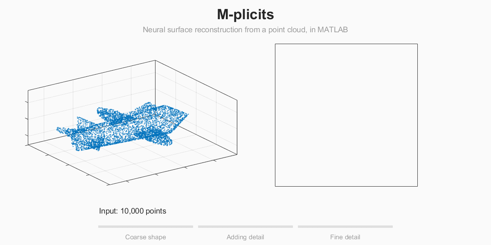

# M-plicits Neural Surface Reconstruction for MATLAB

<!-- project-download-link:start -->
📦 Download this project [here](https://github.com/mathworks/Research-Office-Projects/releases/download/project-downloads/package-mplicit-surface-meshing.zip).
<!-- project-download-link:end -->



`pc2mplicitmesh` turns an oriented point cloud into a watertight surface mesh
using M-plicits, a multiscale neural implicit surface. It is used like
`pc2surfacemesh`:

```matlab
mesh = pc2mplicitmesh(ptCloud);      % ptCloud: pointCloud with outward normals
surfaceMeshShow(mesh)
```

The surface is the zero level set of a sum of sinusoidal neural networks
(SIRENs), F = F0 + R1 + R2, trained coarse to fine. F0 is a smooth coarse
signed distance field. Each residual Rk uses a higher frequency, is trained
with the coarser levels frozen, and only adds detail in a band around the
surface. This is a from-scratch MATLAB implementation inspired by the method in
*M-plicits: Neural Implicit Surfaces via Nested Multiscale Residuals*
(NeurIPS 2026).

## Getting started

Open and run `mplicitDemo.m`. It is a Live Script that reconstructs an
   aircraft model, shows how the levels of the field build up the surface,
   and compares the result with Screened Poisson.

`pc2mplicitmesh` is a standalone .m file that can be moved and used in other projects.

## Options

| Name | Default | Meaning |
|---|---|---|
| `NumLevels` | 3 | Levels to train (1 to 3). Fewer is faster but smoother. |
| `Resolution` | 256 | Meshing grid samples per axis. |
| `MinComponentFraction` | 0.01 | Remove disconnected pieces smaller than this fraction of the surface area (0 keeps all). |
| `UseGPU` | true | Train on the GPU when one is available. |
| `Verbose` | true | Print training progress. |
| `Levels` | paper schedule | Advanced: per-level `HiddenSizes`, `Omega0`, `NumIterations`. |

The second output, `info`, holds the trained field, the normalization, and
the training and meshing times.

## Performance

Training is designed for the GPU. On the CPU the result is the same, but a
full 3-level fit takes on the order of an hour, and `pc2mplicitmesh` warns
when it trains on the CPU.

## Requirements

- MATLAB R2025a or later (the example is a plain-text Live Script)
- Deep Learning Toolbox
- Computer Vision Toolbox (`pointCloud`, `surfaceMesh`)
- Image Processing Toolbox
- Statistics and Machine Learning Toolbox
- Parallel Computing Toolbox and a supported GPU (recommended)

The example also reads `fixedwing.stl`, which is installed with Robotics
System Toolbox, UAV Toolbox, and related toolboxes.

## Tips

- Normals must point **out** of the shape. For scanned clouds, estimate them
  with `pcnormals` and fix their orientation before fitting.
- The cloud may be in any units and position; it is normalized internally and
  the mesh is returned in the original coordinates.

## Folder contents

| Path | Contents |
|---|---|
| `pc2mplicitmesh.m` | The function, with its whole implementation as local functions: training, field evaluation, meshing. |
| `mplicitTraining.gif` | Animation shown at the top of this README. |
| `mplicitDemo.m` | Live Script example. |
| `samplePointCloudFromMesh.m`, `blueNoiseEliminate.m` | Example helpers: sample an oriented point cloud from an STL mesh. |
