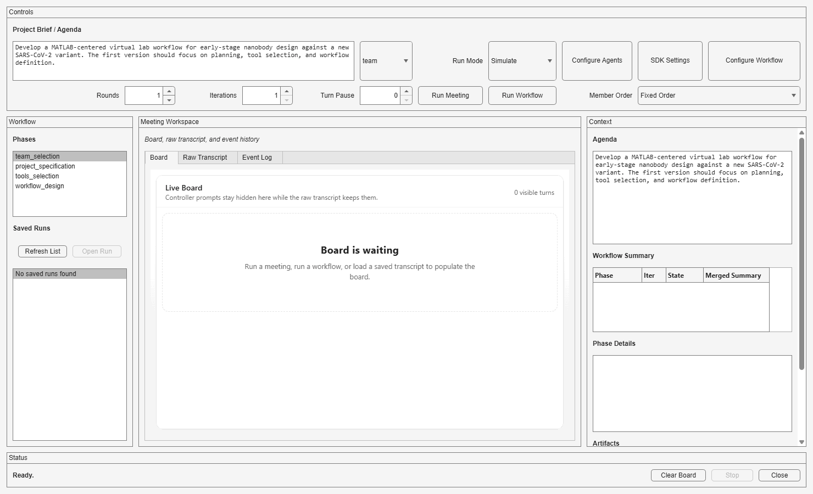
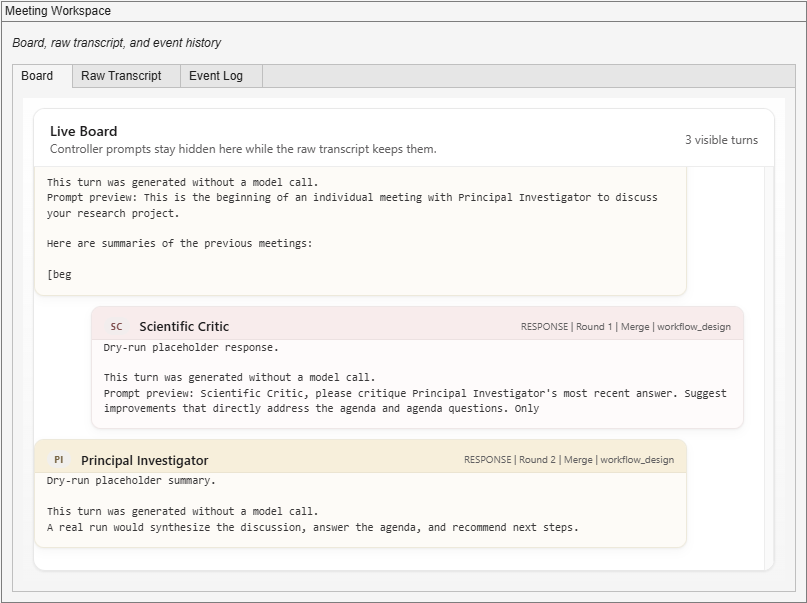
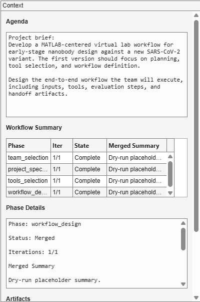

# Virtual Lab for MATLAB&reg;



Virtual Lab for MATLAB is a conversation-centric prototype for structured multi-agent collaboration in MATLAB. The app and its MATLAB runtime own the shared conversation: they maintain its history, schedule participant turns, and save the transcript. Each participant contributes through its configured LLM, while the conversation exists independently of any one model or agent session. Saved conversations can be reopened in the app for inspection without making model calls.

Instead of hand-rolling agent loops, transcript handling, turn scheduling, and phase-to-phase state passing, you define specialist agents, run reproducible meetings or multi-phase workflows, inspect the shared transcript and workspace, and switch between simulated runs and model calls made through [MATLAB AI Agent SDK](https://www.mathworks.com/products/matlab-ai-agent-sdk.html), while the orchestration logic stays explicit and editable.

The scope is intentionally limited to conversation and workflow orchestration. The package **does not include domain tools** for retrieval, scientific computation, or experimental execution. You make it useful for your own work by supplying tools through the SDK and adapting the agents and workflows. Without those extensions, SDK-backed runs can discuss and plan research, but do not execute the methods described in the discussion.

This is a MATLAB implementation inspired by [`zou-group/virtual-lab`](https://github.com/zou-group/virtual-lab), described in Swanson, K., Wu, W., Bulaong, N.L. et al., "The Virtual Lab of AI agents designs new SARS-CoV-2 nanobodies," *Nature* (2025), https://doi.org/10.1038/s41586-025-09442-9. In that work, an LLM principal investigator coordinates specialist LLM scientist agents through research meetings and the system created 92 new nanobodies against recent SARS-CoV-2 variants. The MATLAB runtime and app code are independent, but the meeting structure, parts of the prompt flow, and the included nanobody-design scenario are adapted from that project. See [Third-Party Notices](THIRD_PARTY_NOTICES.md).

The included scenario uses nanobody discovery for a new SARS-CoV-2 variant as a *planning* topic. It illustrates collaborative discussion and workflow orchestration; it does not perform nanobody design or validation. Change the project brief, agents, tools, and workflow phases to adapt it to other research topics.

## Quick start

From the package folder, run a simulated meeting. No credentials or SDK are needed:

```matlab
demoVirtualLabDryRun            % one team meeting
demoVirtualLabWorkflowDryRun    % the four-phase workflow
demoVirtualLabApp               % the app
```

In the app, keep **Run Mode** set to **Simulate** to run meetings and workflows without model calls. Simulated runs produce placeholder turns, not scientific results.

## Requirements

- MATLAB R2024a or later. No additional toolboxes are required for the simulated demos or the app in **Simulate** mode.
- [MATLAB AI Agent SDK](https://www.mathworks.com/products/matlab-ai-agent-sdk.html) v0.4.0 or later for real model calls, declared in [`matlab.toml`](matlab.toml). With MATLAB R2026b or later, MPM installs the dependencies declared there automatically. On earlier releases, install the SDK separately. You also need credentials for your model provider.

Keep the MATLAB files, `matlab.toml`, `board_ui.html`, and the `workflow_presets` folder together.

## How it works

The conversation is the central object. The runtime keeps one shared meeting history, one shared workspace struct, and one ordered speaking schedule. Each participant has its own title, expertise, goal, role, generated system prompt, and model, but they all speak into the same history:

```text
                 +-----------------------------------+
                 |         shared meeting state      |
                 |-----------------------------------|
                 | messages: runtime prompts + turns |
                 | workspace: shared MATLAB struct   |
                 +----------------+------------------+
                                  |
                     next speaker in meeting order
                                  |
                                  v
                 +-----------------------------------+
                 |      current participant turn     |
                 |-----------------------------------|
                 | system prompt: participant role   |
                 | model: participant model          |
                 | input: shared history + new prompt|
                 +----------------+------------------+
                                  |
                                  v
                         participant response
                                  |
                                  v
                 append response into shared history
                                  |
                                  v
                           next participant
```

At each turn the runtime can inject hidden turn instructions, but the visible transcript records only participant responses. The live board shows those participant turns, while the raw transcript tab keeps everything:



In team meetings, the principal investigator is the visible chair: it opens the meeting, frames the discussion, and summarizes decisions, while the runtime stays as hidden control logic. Keeping the flow in the runtime rather than letting the lead decide it makes participation order, coverage, and stopping conditions independent of model behavior, so every configured participant gets a turn and repeated iterations are easier to compare.

There are two layers:

1. **`runVirtualMeeting`** runs one conversation: a team discussion, an individual critique loop, or a merge step.
   - `team` meetings have a lead plus team members. By default participants speak in a fixed order; the app can randomize the non-lead order once per meeting.
   - `individual` meetings pair one agent with a built-in scientific critic.
   - `NumRounds` sets how many discussion passes happen before the final summary.
   - Transcripts are saved as JSON and Markdown.
2. **`runVirtualLabWorkflow`** runs a sequence of phases on top of the meeting primitive. Each phase defines its own agenda and participants, runs `NumIterations` separate meetings on the same agenda, then runs one merge meeting, chaired by the phase lead, that synthesizes the iteration summaries. Merged summaries carry forward into later phases. The default phases are `team_selection`, `project_specification`, `tools_selection`, and `workflow_design`.



`NumRounds` and `NumIterations` are separate from the SDK's `MaxIterations`, which limits tool-calling steps inside a single agent turn.

## Using MATLAB AI Agent SDK

1. Install [MATLAB AI Agent SDK](https://www.mathworks.com/products/matlab-ai-agent-sdk.html) v0.4.0 or later and make sure it is on the MATLAB path. If you cloned it from [GitHub](https://github.com/matlab/matlab-ai-agent-sdk), run `addpath("path/to/matlab-ai-agent-sdk")`, or set **SDK Location** in the app's **SDK Settings**.
2. Put your provider credentials, for example `OPENAI_API_KEY`, in a `.env` file in this package folder, where `.gitignore` keeps it out of source control. Load it with `loadenv(".env")` or **SDK Settings > Load Env**.
3. Call `runVirtualMeeting` or `runVirtualLabWorkflow` with `UseSDK=true` and `DryRun=false`, or choose **Run Mode > Use SDK** in the app. **SDK Settings > Test Connection** checks the provider before a run.

```matlab
loadenv(".env")
projectBrief = "Plan an early-stage nanobody design workflow against a new SARS-CoV-2 variant.";
results = runVirtualLabWorkflow(projectBrief, ...
    SaveRoot="workflow_output_real", ...
    UseSDK=true, ...
    DryRun=false, ...
    Provider="openai");
```

The app supports OpenAI, OpenAI-compatible endpoints (with a base URL), and Ollama. Models are configured per agent; the default is `gpt-5-mini`.

## Extending with tools

Both `runVirtualMeeting` and `runVirtualLabWorkflow` accept a `Tools` name-value argument, which defaults to empty. Supply tools compatible with MATLAB AI Agent SDK when running with `UseSDK=true` and `DryRun=false`. The workflow forwards the tools to its meetings, and all participants within a meeting receive the same tool access.

Start with the SDK's [Create AI Agent With Tools](https://github.com/matlab/matlab-ai-agent-sdk/tree/v0.4.0#create-ai-agent-with-tools) example, which wraps a MATLAB function with `aisdk.LLMTool` and describes its inputs with `aisdk.LLMToolArgument`. For tools that work with MATLAB data in the shared workspace, see [Configure Tool to Use Agent Workspace](https://github.com/matlab/matlab-ai-agent-sdk/tree/v0.4.0#configure-tool-to-use-agent-workspace). To adapt the prototype to a real task:

1. Implement or connect the retrieval, computation, or external-service tools your task requires.
2. Pass them through `Tools` in your meeting or workflow call.
3. Update the project brief, participant roles, and workflow phases to describe how those capabilities should be used.

The app does not provide a tool-configuration UI. To use tools from the app, extend its calls to the runtime in [`launchVirtualLabApp.m`](launchVirtualLabApp.m). The bundled `tools_selection` phase discusses which tools a project needs; it does not install or register tools.

## App features

- Run a single meeting or the configured workflow, in **Simulate** or **Use SDK** mode.
- Tabs for the `uihtml` live board, the raw transcript, and the event log.
- A workflow summary table with per-phase drill-down into merged output, iteration summaries, and saved artifacts.
- **Configure Agents** to edit models, roles, and single-meeting participants. The selected **Team Lead** is the visible chair.
- **Configure Workflow** to edit phase structure, agendas, and per-phase participants, with preset save, load, rename, and delete. Bundled presets: `Starter - Default Planning`, `Starter - Fast Triage`, and `Starter - Single Review Loop`. The last-used preset is remembered in `.virtual_lab_app_settings.json`.
- **SDK Settings** for SDK location, `.env` loading, provider, optional base URL, and a connection test.
- **Stop** for cooperative cancellation between turns, and a saved-runs browser that reloads prior JSON transcripts into the board.

## Scope

Covered: role-based, configurable agents; team and individual meetings; a shared transcript and workspace across turns; multi-phase workflows; simulated and SDK-backed execution; and the app.

Not covered: ESM, AlphaFold&trade;-Multimer, or Rosetta&trade; execution; PubMed&reg; or web retrieval tools; real scientific scoring or ranking logic; and parallel execution of meeting iterations. Domain capabilities are user-supplied extensions: MATLAB tools, external wrappers, or MCP-backed integrations exposed through the SDK.

## Folder contents

| Path | Contents |
|---|---|
| `virtualLabAgent.m` | Creates an agent spec with title, expertise, goal, role, model, and generated system prompt. |
| `runVirtualMeeting.m` | Runs a single team or individual meeting; the core meeting engine. |
| `runVirtualLabWorkflow.m` | Runs a multi-phase workflow by calling `runVirtualMeeting` for each iteration and merge. |
| `defaultWorkflowPhaseConfigs.m` | Default workflow phase definitions. Use `{{PROJECT_BRIEF}}` to inject the brief at run time. |
| `launchVirtualLabApp.m`, `board_ui.html` | The app and its live-board view. |
| `demoVirtualLabDryRun.m`, `demoVirtualLabWorkflowDryRun.m`, `demoVirtualLabApp.m` | Simulated meeting and workflow demos, and the app launcher. |
| `workflow_presets/` | Bundled starter workflow presets; presets you save in the app also go here. |
| `matlab.toml` | Declares the MATLAB AI Agent SDK dependency. |
| `images/` | Animation and screenshots used in this README. |

Runs write transcripts to `output/`, `workflow_output/`, and `ui_runs/`, which `.gitignore` excludes.

## License

Licensed under the repository's MathWorks BSD-3-Clause License. See [LICENSE](../../LICENSE). Adapted third-party material is attributed in [Third-Party Notices](THIRD_PARTY_NOTICES.md).
