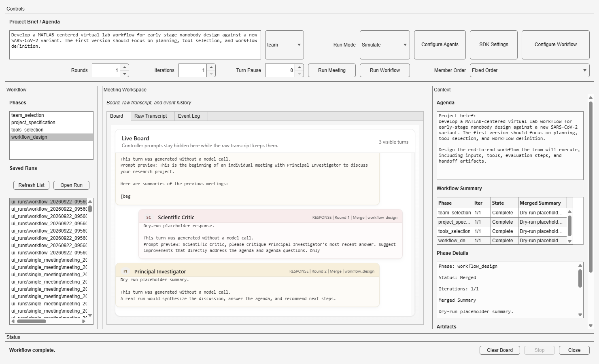
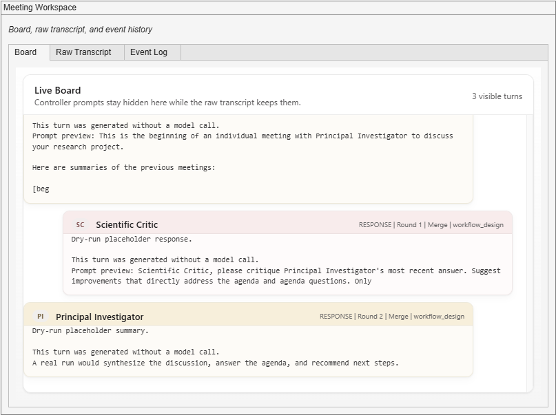
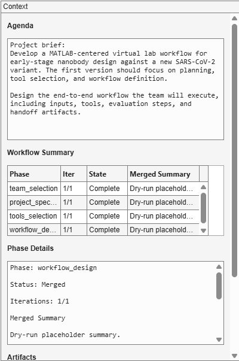

# Virtual Lab for MATLAB

Virtual Lab for MATLAB is a conversation-centric prototype for structured multi-agent collaboration in MATLAB&reg;. The app and its MATLAB runtime own the shared conversation: they maintain its history, schedule participant turns, and save the transcript. Each participant contributes through its configured LLM, while the conversation exists independently of any one model or agent session. Saved conversations can be reopened in the app for inspection without making model calls.

The scope is intentionally limited to conversation and workflow orchestration. The repository includes the app, meeting runtime, configurable agents, and simulated demos, but **does not include domain tools** for retrieval, scientific computation, or experimental execution. Users make it useful for their own work by supplying tools through the separate [MATLAB AI Agent SDK](https://www.mathworks.com/products/matlab-ai-agent-sdk.html) and adapting the agents and workflows. Without those extensions, SDK-backed runs can discuss and plan research, but do not execute the scientific methods described in the discussion.

This repository is a MATLAB implementation inspired by `zou-group/virtual-lab`. The MATLAB runtime and app code are independent, but the meeting structure, parts of the prompt flow, and the included nanobody-design scenario are adapted from the Virtual Lab project and paper. See [Third-Party Notices](THIRD_PARTY_NOTICES.md) for license attribution.

The `zou-group/virtual-lab` repository is part of the work described in Swanson, K., Wu, W., Bulaong, N.L. et al., "The Virtual Lab of AI agents designs new SARS-CoV-2 nanobodies," *Nature* (2025), https://doi.org/10.1038/s41586-025-09442-9. That paper presents a Virtual Lab in which an LLM principal investigator coordinates specialist LLM scientist agents through research meetings, with human feedback at a high level, and reports that the system created 92 new nanobodies against recent SARS-CoV-2 variants.

The included demo uses nanobody discovery targeting a new SARS-CoV-2 variant as a planning scenario. It illustrates collaborative discussion and workflow orchestration; it does not perform nanobody design or validation. The same structure can be adapted to other research topics by changing the project brief, agents, tools, and workflow phases.

Instead of asking users to hand-roll agent loops, transcript handling, turn scheduling, and phase-to-phase state passing, this prototype provides those pieces as a reusable MATLAB runtime. A user can define specialist agents, run reproducible meetings or multi-phase workflows, inspect the shared transcript and workspace, and switch between simulated runs and SDK-backed model calls while keeping the orchestration logic explicit. The code is also intended as a foundation for customization: users can alter the meeting architecture, add domain-specific tools, change workflow phases, and adapt the prototype to their own research process.

## Requirements

- MATLAB R2024a or later. The prototype uses modern MATLAB function signatures with `arguments` blocks and app UI components such as `uihtml`.
- No additional toolboxes are required for the included dry-run demos or the app in simulated mode.
- [MATLAB AI Agent SDK v0.4.0](https://github.com/matlab/matlab-ai-agent-sdk/releases/tag/v0.4.0) is required for SDK-backed model calls. You must also configure credentials for the model provider you plan to use.

## Installation

Download or clone the repository. In Research Office Projects, this package is located in `Packages/virtual-lab-for-matlab`. Open that folder in MATLAB, or add the downloaded package folder to your path:

```matlab
addpath("path/to/virtual-lab-for-matlab")
```

Keep the MATLAB files, `board_ui.html`, and `workflow_presets` folder together. Install MATLAB AI Agent SDK v0.4.0 separately only when using real model calls.

## Quick Start

From the package folder, run a simulated meeting without credentials or the SDK:

```matlab
demoVirtualLabDryRun
```

Run `demoVirtualLabWorkflowDryRun` for a multi-phase simulation, or `demoVirtualLabApp` to open the app. In the app, select **Simulate** before starting a meeting or workflow. These demos produce simulated discussions, not scientific results.

## Screenshots

The app provides a live board for participant turns, a workflow summary table for phase progress, and detail panes for agenda, summaries, and saved artifacts.



The live board shows participant-visible turns while controller prompts stay hidden.



The workflow summary table tracks each phase, iteration progress, completion state, and merged output.



## Architecture

The conversation is the central application object. The MATLAB runtime maintains the shared meeting history and passes it to the current participant for each turn. Each participant can use a different configured model while contributing to the same conversation.

The runtime saves the participant transcript as JSON and Markdown, and the app can reload saved JSON transcripts into its board. This persistence supports later inspection; reopening a transcript does not resume an agent session or restore a running meeting.

Each participant has:

- its own title, expertise, goal, and role
- its own generated system prompt
- its own configured model

The meeting keeps:

- one shared conversation history
- one shared workspace struct
- one ordered speaking schedule

At each turn, the runtime can inject hidden turn instructions, but the visible transcript records only participant responses. The current participant is executed with its own system prompt and model against the shared meeting history, and the resulting response is appended back into that shared history so later participants can react to it.

```text
                 +-----------------------------------+
                 |         shared meeting state      |
                 |-----------------------------------|
                 | messages: runtime prompts + turns |
                 | workspace: shared MATLAB struct   |
                 +----------------+------------------+
                                  |
                     next speaker in meeting order
                                  |
                                  v
                 +-----------------------------------+
                 |      current participant turn     |
                 |-----------------------------------|
                 | system prompt: participant role   |
                 | model: participant model          |
                 | input: shared history + new prompt|
                 +----------------+------------------+
                                  |
                                  v
                         participant response
                                  |
                                  v
                 append response into shared history
                                  |
                                  v
                           next participant
```

This gives each participant a distinct identity without splitting the meeting into separate private histories.

In team meetings, the principal investigator is the visible chair in the transcript: it opens the meeting, frames the discussion, and summarizes decisions, while the MATLAB runtime stays as hidden control logic.

We chose this split deliberately. Letting the PI or team lead decide the live flow of the meeting would make participation order, coverage, and stopping conditions depend on model behavior. Keeping that control in the runtime makes meetings more predictable and reproducible, ensures every configured participant gets a turn, and makes repeated workflow iterations easier to compare.

## Workflow Structure

The prototype supports both single meetings and multi-phase workflows.

A single meeting is the basic collaboration unit. By default, participants speak in a fixed configured order, respond to each other over multiple back-and-forth rounds, and end with a summary that captures the current recommendation and next steps. For team meetings, the app can optionally randomize the non-team-lead participant order once per meeting while keeping the team lead fixed as chair.

A workflow builds on that meeting primitive. Each phase defines its own agenda and participants, can repeat the same meeting multiple times as separate iterations, and then runs a merge step that synthesizes the iteration summaries into one phase result to carry forward.

Both layers are configurable. Agent roles, goals, and models can be edited, and workflow phases can be changed in structure, agenda, and participants.

At a high level, the structure is:

- one meeting = ordered participant turns across several rounds
- one workflow phase = one or more meeting iterations plus one merge step
- one workflow = a sequence of phases whose merged outputs feed later phases

This is separate from the SDK's `MaxIterations` setting, which limits tool-calling steps inside a single agent turn rather than meeting rounds, workflow iterations, or workflow phases.

## Scope

This prototype intentionally provides the conversation and orchestration layer. It currently covers:

- role-based agent definitions
- configurable agent definitions and configurable workflow phases
- team meetings and individual meetings
- shared transcript and shared workspace across turns
- multi-phase workflow orchestration built on top of the meeting primitive
- simulated execution for local validation
- SDK-backed execution for real model calls
- a `uifigure` app for configuring, running, and inspecting meetings and workflows

It does not currently cover:

- ESM, AlphaFold&trade;-Multimer, or Rosetta&trade; execution
- PubMed&reg; or web retrieval tools
- real scientific scoring or ranking logic
- parallel execution of multiple meeting iterations

Domain capabilities are user-supplied extensions. They can be added as MATLAB tools, external wrappers, or MCP-backed integrations exposed through the SDK. Parallel execution of multiple meeting iterations would require changes to the workflow orchestration layer.

## Extending With Tools

Both `runVirtualMeeting` and `runVirtualLabWorkflow` accept a `Tools` name-value argument, which defaults to empty. Supply tools compatible with the MATLAB AI Agent SDK through this argument when running with `UseSDK=true` and `DryRun=false`. The workflow forwards the tools to its meetings, and all participants within a meeting receive the same tool access.

Start with the SDK's [Create AI Agent With Tools](https://github.com/matlab/matlab-ai-agent-sdk/tree/v0.4.0#create-ai-agent-with-tools) example, which shows how to wrap a MATLAB function with `aisdk.LLMTool` and describe its inputs and outputs with `aisdk.LLMToolArgument`. Pass the resulting tools to this prototype's `Tools` argument. For tools that work with MATLAB data in the shared workspace, see [Configure Tool to Use Agent Workspace](https://github.com/matlab/matlab-ai-agent-sdk/tree/v0.4.0#configure-tool-to-use-agent-workspace).

To adapt the prototype to a real task:

1. Implement or connect the retrieval, computation, or external-service tools your task requires using the SDK's tool interfaces.
2. Pass those tools through `Tools` in your meeting or workflow call.
3. Update the project brief, participant roles, and workflow phases to describe how those capabilities should be used.

The app does not currently provide a tool-configuration UI. To use your tools from the app, extend its calls to the runtime in [`launchVirtualLabApp.m`](./launchVirtualLabApp.m). The bundled `tools_selection` phase discusses which tools a project needs; it does not install or register tools.

## Repository Layout

- [`virtualLabAgent.m`](./virtualLabAgent.m)
  Creates an agent spec with title, expertise, goal, role, model, and generated system prompt.

- [`runVirtualMeeting.m`](./runVirtualMeeting.m)
  Runs a single meeting. This is the core meeting engine.

- [`runVirtualLabWorkflow.m`](./runVirtualLabWorkflow.m)
  Runs a multi-phase workflow by calling `runVirtualMeeting` repeatedly.

- [`defaultWorkflowPhaseConfigs.m`](./defaultWorkflowPhaseConfigs.m)
  Provides the shared default workflow phase definitions.

- [`launchVirtualLabApp.m`](./launchVirtualLabApp.m)
  Launches the app for running a single meeting or the full workflow.

- [`demoVirtualLabDryRun.m`](./demoVirtualLabDryRun.m)
  Minimal simulated example for one team meeting.

- [`demoVirtualLabWorkflowDryRun.m`](./demoVirtualLabWorkflowDryRun.m)
  Simulated example for the multi-phase workflow.

- [`demoVirtualLabApp.m`](./demoVirtualLabApp.m)
  Opens the app.

## Runtime Model

There are two layers:

1. `runVirtualMeeting`
   Runs one conversation.
   Examples: one team discussion, one individual critique loop, one merge step.

2. `runVirtualLabWorkflow`
   Runs a sequence of phases.
   Examples: team selection, project specification, tool selection, workflow design.

This uses a reusable meeting primitive underneath higher-level workflow orchestration.

`runVirtualMeeting` supports:

- `team` meetings with a lead plus team members
- `individual` meetings with one primary agent plus the built-in scientific critic
- configurable participant definitions, including titles, roles, goals, and models
- `NumRounds`, which controls how many discussion passes happen inside one meeting before the final summary
- `DryRun=true` simulated responses; this is the same mode exposed as `Simulate` in the app UI
- `UseSDK=true` real model-backed turns
- one shared tool set per meeting; currently all participants in that meeting receive the same tool access
- transcript saving to JSON and Markdown

`runVirtualLabWorkflow` sits above the meeting engine. For each phase it:

- defines the agenda and participating agents
- can use editable phase definitions rather than only the bundled defaults
- uses `NumIterations` to run several separate meetings for the same phase agenda
- collects the summary from each iteration
- runs one additional merge meeting after the iterations finish to synthesize those summaries into a single phase result
- carries merged summaries forward into later phases

The default phases are:

- `team_selection`
- `project_specification`
- `tools_selection`
- `workflow_design`

## Running The Demos

To validate the single-meeting layer:

```matlab
run("demoVirtualLabDryRun.m")
```

To validate the workflow layer:

```matlab
run("demoVirtualLabWorkflowDryRun.m")
```

To open the app:

```matlab
run("demoVirtualLabApp.m")
```

## App Features

The app currently supports:

- running a single meeting or the default workflow
- a `Run Mode` selector with `Use SDK` and `Simulate`, where `Simulate` maps to `DryRun=true` in the underlying code
- a tabbed workspace with a `uihtml` live board, raw transcript, and event log
- a workflow phase summary table with per-phase drill-down for merged output, iteration summaries, and saved artifacts
- a `Configure Agents` dialog for editing models, prompt roles, and single-meeting participants, where the selected `Team Lead` is the visible chair for team meetings
- a `Configure Workflow` dialog for editing phase structure, agendas, and per-phase participants, where the selected `Team Lead` is the visible chair for team phases
- workflow preset save/load, rename/delete, bundled starter presets, and last-used preset restore in `workflow_presets`
- an `SDK Settings` dialog for choosing SDK location, loading a `.env`, selecting provider, optional base URL, and testing connectivity
- a `Stop` button for cooperative cancellation between turns
- a saved-runs browser that can reload prior JSON transcripts into the board

Bundled starter presets currently include:

- `Starter - Default Planning`
- `Starter - Fast Triage`
- `Starter - Single Review Loop`

The app creates `.virtual_lab_app_settings.json` at runtime to remember the last-used workflow preset.

## Using The MATLAB AI Agent SDK

The SDK is a separate dependency needed for real model calls instead of simulated responses:

1. Download and install [MATLAB AI Agent SDK v0.4.0](https://github.com/matlab/matlab-ai-agent-sdk/releases/tag/v0.4.0) separately. Use this specific release to keep the demo's SDK dependency fixed.
2. Add the SDK to the MATLAB path.
3. Configure credentials for the provider you want to use.
4. Call `runVirtualMeeting` or `runVirtualLabWorkflow` with `UseSDK=true` and `DryRun=false`, or choose `Run Mode = Use SDK` in the app.

Example:

```matlab
addpath("path/to/MATLABAIAgentSDK")

results = runVirtualLabWorkflow(projectBrief, ...
    SaveRoot="workflow_output_real", ...
    UseSDK=true, ...
    DryRun=false, ...
    Provider="openai");
```

## License

See [repository license](../../LICENSE) for the license terms and [Third-Party Notices](THIRD_PARTY_NOTICES.md) for attribution of adapted material.
